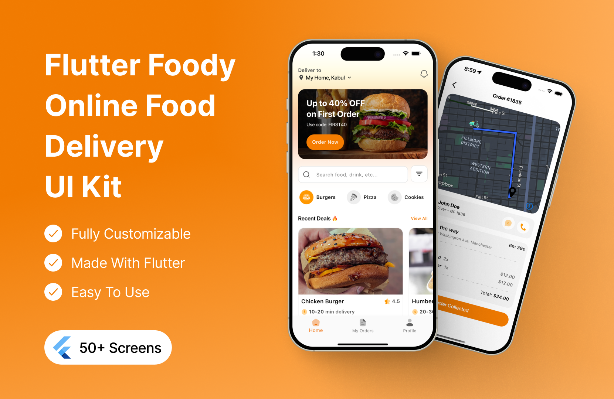
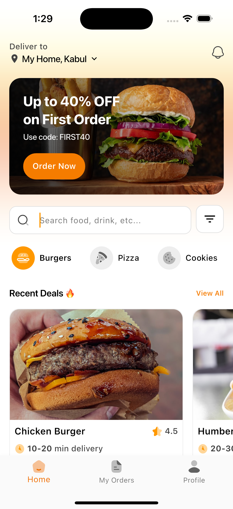
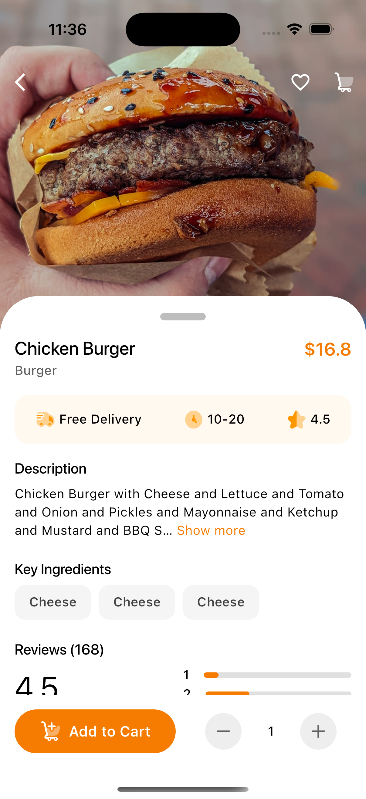
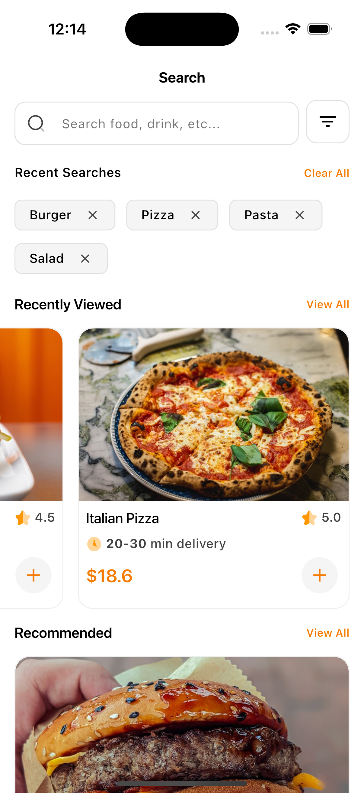
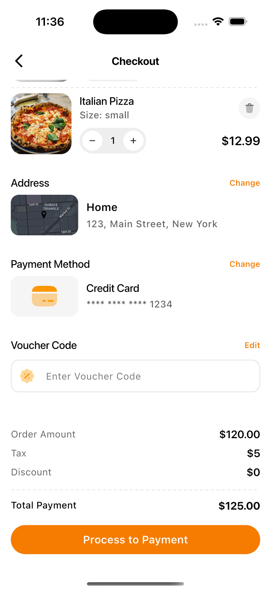
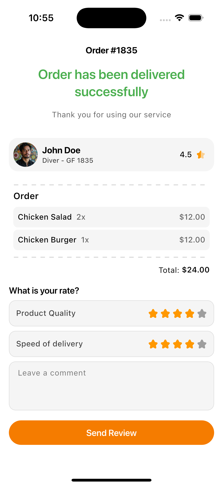

# Foody — Flutter Food Delivery Application UI

**iDyAy** – A vibrant, premium Flutter UI for food‑delivery apps, showcasing smooth micro‑animations, glass‑morphism design, and fully responsive layouts for mobile, tablet, and web.



A modern, responsive, and beautifully designed **Flutter Food Delivery Application UI** created by **[Leul Chali](https://github.com/leul-chali)**. Built with Flutter & Dart, this project showcases a complete end-to-end mobile user experience for online food ordering, browsing, cart management, checkout, and order reviews.

---

## 📱 Features

- **Modern & Vibrant Design:** Tailored color palette, rounded cards, micro-interactions, and intuitive layout.
- **Home & Discovery:**
  - Interactive location header with delivery address selector and notifications.
  - Promotional discount hero banner.
  - Category selector (Burgers, Pizza, Cookies, Drinks, Desserts).
  - Recent deals and trending food items.
- **Product Details:**
  - High-resolution hero image header with favorite & cart actions.
  - Interactive bottom sheet with pricing, delivery estimates, expandable descriptions, ingredients, and customer review breakdown.
  - Quantity counter (`- / +`) and reactive Add to Cart CTA.
- **Search & Filter:**
  - Search input with recent searches chip history and clear-all functionality.
  - Recently viewed recommendations with quick-add actions.
- **Cart & Checkout:**
  - Real-time cart calculation and item quantity management.
  - Delivery address card with map indicator.
  - Payment method selector and voucher code application.
  - Itemized financial breakdown (Order Amount, Tax, Discount, Total).
- **Order Tracking & Feedback:**
  - Order completion confirmation.
  - Delivery driver profile information.
  - Interactive multi-criteria star rating (Product Quality, Speed of Delivery) and review comments.

---

## 📸 Screenshots

| Home Screen | Product Details |
| :---: | :---: |
|  |  |

| Search & Discovery | Checkout |
| :---: | :---: |
|  |  |

| Order Delivered & Review | App Overview |
| :---: | :---: |
|  |  |

---

## 🚀 Getting Started

### Prerequisites
- [Flutter SDK](https://flutter.dev/docs/get-started/install) (`>= 3.7.0`)
- [Dart SDK](https://dart.dev/)
- Android Studio / VS Code with Flutter extension
- An Android/iOS simulator or physical device

### Installation

1. **Clone the repository:**
   ```bash
   git clone https://github.com/leul-chali/Flutte_food_delivery.git
   cd Flutte_food_delivery
   ```

2. **Install dependencies:**
   ```bash
   flutter pub get
   ```

3. **Run the application:**
   ```bash
   flutter run
   ```

---

## 🛠️ Tech Stack & Architecture

- **Framework:** [Flutter](https://flutter.dev/) (iOS, Android, Web)
- **Language:** [Dart](https://dart.dev/)
- **Icons:** Material & Cupertino Icons
- **Design System:** Custom theme with primary orange accent (`#FF7A00`), smooth elevations, and responsive card components.

---

## 👤 Author

**Leul Chali**
- GitHub: [@leul-chali](https://github.com/leul-chali)

---

## 📄 License

This project is open-source and available under the [MIT License](LICENSE).
